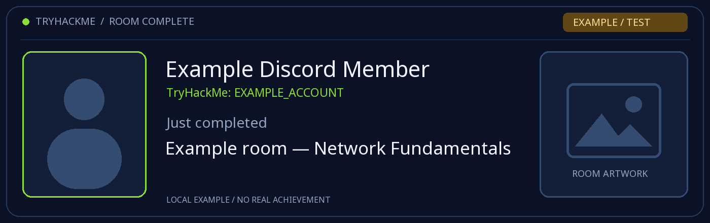

# TryHackMe Discord Achievement Bot

An opt-in Python bot that announces **fully completed TryHackMe rooms** with a PNG achievement card and the room URL. The member's display name, linked TryHackMe username, and completion text appear inside the card. Individual answers do not trigger announcements.

All built-in commands, replies, errors, logs, and documentation are in English. Members' display names, channel names, and external room titles keep their original text.

## Status

The project includes automated tests and optional live diagnostics. Live diagnostics are not run during normal tests and may be affected by TryHackMe rate limits or API changes. See [TEST_REPORT.md](TEST_REPORT.md) for the current local validation summary.

These results describe the test environment at that time. TryHackMe can change its public endpoints or impose new limits. Discord delivery tests use mocks; the user reports that their Discord bot is running, but this project has not independently verified that live deployment.

## Requirements

- Python 3.11 or newer; tested on Windows with Python 3.12.10.
- Outbound HTTPS access to Discord, TryHackMe, and the allowed image hosts.
- An always-on computer or hosting service with persistent storage. Closing the process or suspending the computer stops tracking.
- A public TryHackMe profile and access to its **Biography** field for each member linking an account.

## Create and invite the Discord application

1. Open the [Discord Developer Portal](https://discord.com/developers/applications), create an application, and open its **Bot** settings.
2. Save the bot token only in your local `.env`. Do not post it in chat or commit it. Regenerate it if exposed.
3. Leave the **Message Content**, **Server Members**, and **Presence** privileged intents disabled. The code uses only the `guilds` intent and fetches members through REST when needed.
4. In **OAuth2 → URL Generator**, select `bot` and `applications.commands`, using **Guild Install**.
5. Grant only these channel permissions:

   | Permission | Purpose |
   | --- | --- |
   | View Channel | Access the achievement channel |
   | Send Messages | Publish announcements |
   | Attach Files | Upload the PNG card |
   | Read Message History | Find previous deliveries before retrying uncertain sends |

6. Open the generated invite URL, select your server, and authorize. Review channel permission overrides too.

The bot does not need Administrator or Manage Server. The member running `/setup` or `/test` must have **Manage Server**, checked during execution.

Generic invite URL; replace `YOUR_APPLICATION_ID`:

```text
https://discord.com/oauth2/authorize?client_id=YOUR_APPLICATION_ID&scope=bot%20applications.commands&permissions=101376&integration_type=0
```

References: [Discord OAuth2](https://docs.discord.com/developers/topics/oauth2), [discord.py application commands](https://discordpy.readthedocs.io/en/stable/interactions/api.html).

## Run on Windows

Open PowerShell in the project directory. No environment activation or Execution Policy change is required:

```powershell
cd C:\Path\To\tryhackme-discord-bot
py -3.12 -m venv .venv
.\.venv\Scripts\python.exe -m pip install -r requirements.txt
if (!(Test-Path .env)) {
    Copy-Item .env.example .env
}
notepad .env
.\.venv\Scripts\python.exe -m scripts.probe --username YOUR_USERNAME
.\.venv\Scripts\python.exe -m thm_bot
```

Adjust the directory if you moved the project. Set `DISCORD_TOKEN` before starting. Use another Python 3.11+ installation if `py -3.12` is unavailable. Preserve an existing `.env` when upgrading.

## Run on Linux

Install Python 3.11+ and your distribution's `venv` package, then:

```bash
python3 -m venv .venv
.venv/bin/python -m pip install -r requirements.txt
cp -n .env.example .env
chmod 600 .env
nano .env
.venv/bin/python -m scripts.probe --username YOUR_USERNAME
.venv/bin/python -m thm_bot
```

Use a process supervisor for continuous operation. [The systemd example](deploy/thm-bot.service) assumes a `thmbot` user and `/opt/thm-discord-bot`; create the user and adjust ownership and paths before installing it. Linux deployment has not been tested here. On Windows, Task Scheduler can launch the virtual environment's Python with the project as its working directory and restart on failure. Keep the computer awake.

## Configuration

Process environment variables take precedence over `.env`. Relative database paths resolve inside the project.

| Variable | Default | Meaning |
| --- | --- | --- |
| `DISCORD_TOKEN` | Empty | Required to connect to Discord |
| `DISCORD_DEV_GUILD_ID` | Empty | Optional development server for fast command sync; empty means global commands |
| `POLL_INTERVAL_SECONDS` | `600` | Interval after each successful account check; minimum 60 seconds |
| `REQUEST_INTERVAL_SECONDS` | `2` | Minimum interval between API requests; minimum one second |
| `HTTP_TIMEOUT_SECONDS` | `20` | Total timeout; connection timeout is at most ten seconds |
| `POLL_TIMEOUT_SECONDS` | `120` | Maximum duration of a complete scan or uncertain delivery attempt; incomplete scans do not commit |
| `THM_USER_AGENT` | Empty, automatic | Use the User-Agent matching the Chrome HTTP/TLS profile |
| `THM_ACCEPT_LANGUAGE` | `en-US,en;q=0.9` | Preferred API response language |
| `MAX_IMAGE_BYTES` | `4194304` | Maximum image download size, four MiB |
| `DATABASE_PATH` | `data/bot.sqlite3` | Persistent SQLite database |
| `VERIFY_TTL_SECONDS` | `900` | Verification code lifetime, fifteen minutes |
| `FONT_PATH` | Empty | Optional local font override |
| `IMAGE_ALLOWED_HOSTS` | See `.env.example` | Exact HTTPS image hosts; no wildcard matching |

Remove `DISCORD_DEV_GUILD_ID` and restart to sync globally when moving to production. Discord can take time to refresh global command descriptions. Remove obsolete guild-specific registrations when moving from development to production.

## Upgrade an existing installation

1. Stop the existing bot process.
2. Replace project files while preserving `.env` and the entire `data/` directory.
3. Reinstall `requirements.txt` to include `curl_cffi`.
4. Leave `THM_USER_AGENT=` empty for the matching automatic browser profile. The exact default image allowlist shipped by older versions is automatically upgraded to include `cdn-images.tryhackme.com`. Custom restricted allowlists remain unchanged; include that verified host if you want TryHackMe artwork.
5. Restart. Startup sync updates slash-command descriptions and adds `/myprofile`. SQLite automatically migrates to schema v2 to cache public profile stats. Links, history, and queued announcements are preserved. Back up the complete stopped `data/` directory before upgrading; older builds cannot read schema v2.

English replies apply to new interactions; previously posted Discord messages are not rewritten. Older localized errors saved in SQLite are displayed as an English retry status by `/profile` without changing stored history.

## Commands and account ownership

| Command | Behavior |
| --- | --- |
| `/setup channel:#achievements` | Set this server's achievement channel; requires Manage Server |
| `/link username:your_username` | Start linking your own account and receive a private, temporary code |
| `/verify` | Check your Biography code and save a complete baseline before starting tracking |
| `/unlink` | Stop tracking and delete your link, pending verification, known rooms, and queued events in this server |
| `/myprofile` | Return a private profile PNG with cached stats and tracking status, without a text caption |
| `/profile` | Alias for the same private profile PNG |
| `/test` | Send a clearly marked test card without recording an achievement or pinging anyone; requires Manage Server |

After `/link`, paste the entire code into **Biography** in TryHackMe account settings, save your profile changes, and run `/verify` within fifteen minutes. Your profile must be public. Wait thirty seconds between verification attempts. A new `/link` invalidates the old code. Remove the code from Biography after successful verification if desired.

Tracking starts only after verification. Existing completions become the baseline and are not announced. A TryHackMe account can be tracked in multiple servers after verification in each, but its username is unique within each server. Members can only link their own Discord identity. No TryHackMe password or user-session cookie is used.

## Public API and completion detection

These public endpoints are unofficial and can change:

```text
GET https://tryhackme.com/api/v2/public-profile?username=YOUR_USERNAME
GET https://tryhackme.com/api/v2/public-profile/completed-rooms?username=YOUR_USERNAME&limit=16&page=1
```

The bot normally requests 100 rooms per page and reads every page reported by `totalPages` and `hasNextPage`, without assuming chronological order. Safety limits are 1,000 pages, 100,000 rooms, and two MiB per decompressed API response.

Snapshots validate field types, account identity, privacy, stable pagination totals, and unique room codes. Profile counts before and after collection must match both the page total and the number of unique rooms. Private, inaccessible, malformed, duplicated, or incomplete responses are errors, never empty completion lists. On failure, only retry metadata changes.

New completions are found by room **code**, even if the total count has not changed. Historical codes are retained as a union: a room disappearing and later returning does not produce another announcement. Multiple new rooms are announced separately without claiming exact completion order or time. Individual questions are not tracked.

API requests are paced and accounts are checked across worker turns. HTTP 429 stops subsequent API requests for the full `Retry-After` interval, supporting both seconds and HTTP dates. Without that header, cooldown starts at sixty seconds and doubles up to one hour. Network and 5xx errors receive at most three bounded attempts with backoff and jitter. Repeated account failures can delay checks for up to six hours. Actual latency also depends on membership and pagination.

Polling and Discord delivery run as separate supervised background tasks. A slow API scan does not hold a member's delivery/unlink lock, and complete scans have a configurable timeout. Opening a profile command never starts a scan or causes an announcement; the worker runs without interactions. Per-member locks keep unlinking safe during a send, and late scan results are discarded if the binding was removed.

Discord relative timestamps naturally change from future countdowns to past values once their deadline passes. Profile images instead show “Checking now” or “Queued for automatic check” when due, and future intervals are explicitly labeled as a snapshot of the image's generation time. The image does not animate or update after it is sent. API backoff and processing delays can still postpone a check.

`curl_cffi` uses `impersonate="chrome"` for compatible HTTP/TLS behavior. No user login cookies, CAPTCHA solver, JavaScript challenge solver, or proxy/IP rotation is used. API responses are size-limited during download, redirects are blocked, and only the two fixed public routes are allowed. `aiohttp` handles bounded image downloads. [curl_cffi documentation](https://curl-cffi.readthedocs.io/en/latest/quick_start.html)

This transport succeeded during live testing. It cannot guarantee that TryHackMe will never return 429 again. Persistent restrictions require checking the hosting environment or obtaining supported access from TryHackMe.

## Durable delivery and duplicate risk

A SQLite transaction records each new room and its outbox event together. Failed sends and missing channels leave events queued with persisted retries. Successful sends record message and channel IDs. Settings, links, history, and pending events survive restarts. SQLite uses WAL, foreign keys, and `synchronous=FULL`.

Before sending, the bot stores the attempt and channel. Each attachment filename contains a stable event ID. Before retrying an uncertain send, the bot searches up to **200 recent messages** since event creation in the previous destination for a matching attachment sent by itself. A match is saved without resending, even after `/setup` changes the destination. Unreadable previous history delays retries.

**Rare duplicates remain possible:** Discord can accept a message just before the process exits without saving its ID. Deletion, attachment removal, or enough channel traffic to move the message outside the 200-message search window can cause a duplicate on retry. Discord's own transport retries can also have uncertain outcomes. There is no distributed exactly-once transaction between Discord and SQLite.

Run one process per database and one deployment per token. A database file lock rejects a second process on the same path; independent databases using one token can still duplicate announcements. A deleted previous channel after an uncertain send needs operator attention.

## Cards and image safety

Cards use a dark navy 1400×440 layout: member avatar on the left, display name and linked username in the middle, and room artwork on the right. Text says **Just completed** and identifies full room completion.

The member avatar on achievement cards uses a centered **244×244 square crop (1:1)**, keeping the existing rounded frame.

Each Discord announcement contains only the attached PNG and the clickable room URL, formatted as `<https://tryhackme.com/room/...>` to avoid a second link preview. There is no extra caption or member ping. The card itself contains the completion message. `/test` uses Internal's verified public artwork with a Hard/Linux sample and remains visibly marked EXAMPLE / TEST.

Achievement cards show only the requested metadata: **OS** and **difficulty**, with no CTF/Walkthrough category. OS is derived exclusively from explicit operating-system values in TryHackMe's public `technologyTags`; missing metadata reads **Not provided**, and multiple OS tags are shown together. Difficulty comes directly from the API. Hard/Insane/Expert room titles use a larger 44px title instead of 35px, with a highlighted difficulty badge. [Hard-room preview](examples/card-hard-example.png).

`/myprofile` and `/profile` return a private 1400×760 PNG with completed rooms, total points, global rank, streak, level, badges, announcement counts, and scan status. Stats are cached only after a complete successful API snapshot. Missing optional stats show an em dash, and old links are populated on their next successful scan. Biography and ownership codes are excluded from the profile cache.



The included examples use synthetic or bundled data and do not represent real achievements.

Names shrink or truncate, and room titles wrap to two lines. Missing, corrupt, oversized, or disallowed images use placeholders. Discord avatars are preferred, with TryHackMe avatars as fallback. Bundled Noto fonts preserve multilingual display-name support; some emoji depend on available font coverage.

Images require HTTPS and an exact allowed host, with no redirects, cookies, or environmental proxy. Private/reserved DNS answers are rejected. Downloads have time and byte limits, and decoded images are capped at sixteen million pixels. Large JPEGs are downsampled by libjpeg before decoding, with Pillow's hard source-dimension limit still enforced. Other oversized formats and unsupported artwork, including SVG, fall back safely.

All message mentions are disabled. External names and room titles are rendered inside the PNG and cannot trigger pings. Missing artwork uses a neutral image placeholder rather than a terminal graphic. Announcements do not claim user or root access.

Regenerate the offline example using your virtual environment's Python:

```bash
python -m scripts.preview
```

## Tests and diagnostics

Windows:

```powershell
.\.venv\Scripts\python.exe -m pip install -r requirements-dev.txt
.\.venv\Scripts\python.exe -m pytest -q
.\.venv\Scripts\python.exe -m ruff check .
.\.venv\Scripts\python.exe -m scripts.probe --username YOUR_USERNAME --page-size 16
```

Linux:

```bash
.venv/bin/python -m pip install -r requirements-dev.txt
.venv/bin/python -m pytest -q
.venv/bin/python -m ruff check .
.venv/bin/python -m scripts.probe --username YOUR_USERNAME --page-size 16
```

The probe makes real requests, needs no Discord token, and sends no Discord messages. It exits zero on success or one on failure and writes `examples/live-probe.json`. It never saves Biography or verification codes. Use `--endpoint profile` for just the profile or `--endpoint completed-rooms` for the original first page with `limit=16`. Respect cooldowns between separate probe runs; standalone invocations do not share rate-limit state.

Unit tests use synthetic fixtures and mocked Discord sends only for testing. Runtime code and live probes never substitute fixtures for real API data. See [TEST_REPORT.md](TEST_REPORT.md).

After deploying:

1. Check `/setup` and `/test` with authorized and unauthorized members.
2. Inspect a test card's label, images, channel, and lack of notifications.
3. Try `/verify` before and after saving your valid Biography code.
4. Confirm old rooms stay unannounced, then fully complete a new room and wait for a check.
5. Restart and confirm links/settings persist without duplicate announcements.
6. Temporarily remove Send Messages, restore it, and confirm queued delivery recovers. Keep Read Message History for reconciliation.
7. Check a second server, then unlink in only one of them.

## Files and stored data

```text
thm_bot/
  __main__.py       Startup and process lock
  config.py         Environment settings and validation
  api.py            API validation, pagination, images, and rate limits
  transport.py      Bounded Chrome-compatible API transport
  models.py         Data models and safe errors
  db.py             SQLite transactions and durable outbox
  service.py        Verification, polling, and retries
  card.py           Pillow PNG rendering
  profile_card.py   Private cached-profile PNGs and truthful due-check labels
  discord_app.py    Slash commands, permissions, and Discord sends
scripts/            Live diagnostics and offline preview
tests/              Local tests without live Discord delivery
assets/             Noto fonts and licenses
examples/           Preview cards and diagnostic reports
deploy/             Example systemd service
```

Stored data includes server/member IDs, linked usernames, public avatar URLs, public profile stats, completed-room codes, and delivery state. Verification codes are temporary, consumed on activation, and deleted by `/unlink`; expired requests are cleaned when a new request is created. Biography text and passwords are never stored. Profile-cache rows are deleted with their account link.

`/unlink` deletes logical records for that server's link. Earlier Discord messages and operator backups remain under the operator's retention policy. SQLite deletion is not forensic erasure of old disk pages.

Protect `.env` and `data/`; both are ignored by Git. For a simple backup, stop the bot and copy the entire `data` directory, including WAL/SHM files if present. Do not copy only the main database while it is being written. Restore with the correct token and database path, then start one instance.
